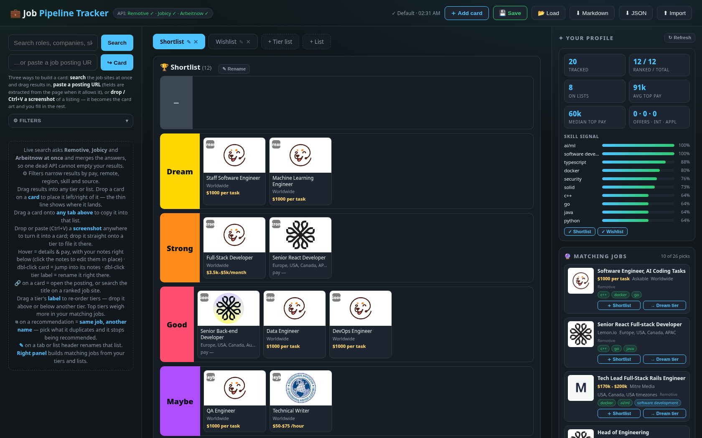
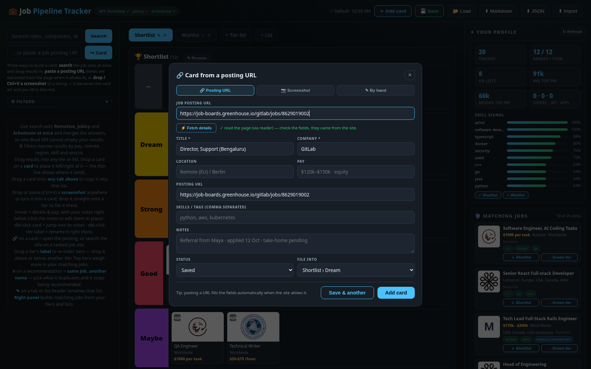

# Some HTML scripts

## anime-custom-lists


## jobs-custom-lists
A job-hunt tracker built on the same bones as the anime list: drag-and-drop tier
lists, live multi-source search, save slots and export — but the cards are job
postings, and **a card can be created three ways**.



**Turn a posting URL into a card.** Paste any job URL and hit ⚡ *Fetch details*:
the page is read through a public relay (`r.jina.ai`, then allorigins/corsproxy)
and the title, company and description are pulled out of it, so a Greenhouse
posting fills itself in. Boards that block the relay still make a card — you
type the fields and the URL is kept as the “open posting” link.



**Turn a screenshot into a card.** Drop an image anywhere on the page, press
Ctrl+V, or pick a file: the screenshot becomes the card’s artwork (downscaled
through a canvas so localStorage survives) and the card is flagged 📷. Drop it
straight onto a tier and it is filed there.

**Or type it by hand** — title, company, location, pay, skills, status, notes,
and which tier or list it lands in.

Everything else mirrors the anime app:

- **Live search over Remotive, Jobicy and Arbeitnow at once** (all CORS-open,
  key-free) — every provider is probed at boot and re-probed every 45s, so one
  dead API cannot empty your results; the header pill shows who is answering.
- Drag cards between tiers and lists, drop one on a card to place it left/right
  of it (the thin line shows where it lands), drag onto a tab to copy it into
  another list, drag a tier’s label to re-order tiers.
- Filters narrow results by pay, remote, region, skill and source; pay strings
  (`$3.5k–$5k/month`, `$50–$75/hour`, `€60k–80k`) are annualised so stats and
  the min-pay filter compare on one scale.
- Hover = pay, company, description and your notes, editable in place;
  dbl-click a card to jump into its notes; dbl-click a tier label to rename it.
- Pipeline status per card (Saved → Applied → Screening → Interview → Offer →
  Rejected), switchable from the tooltip.
- 🔗 on any card opens the posting itself, or searches the title on LinkedIn,
  Indeed, Glassdoor, Wellfound or Google Jobs.
- The right panel builds a profile from your tiers and lists (tier weight ×
  status × pay → top skills) and pulls matching postings from the same three
  providers, with “why” chips, load-more, and ⧉ duplicates (“same job, another
  name”).
- Save slots in localStorage with autosave, plus markdown and JSON
  export/import.

```bash
# the jobs app is a single file — open it directly
xdg-open jobs-custom-lists.html

# its smoke suite (real HTTP fixtures, replayed — offline and deterministic)
cd tests && npm run test:jobs
```

See [`docs/jobs-api-capabilities.md`](docs/jobs-api-capabilities.md) for the
measured capabilities of the three job APIs and the extraction relay, and
[`tests/README.md`](tests/README.md) for how the suite replays them.
